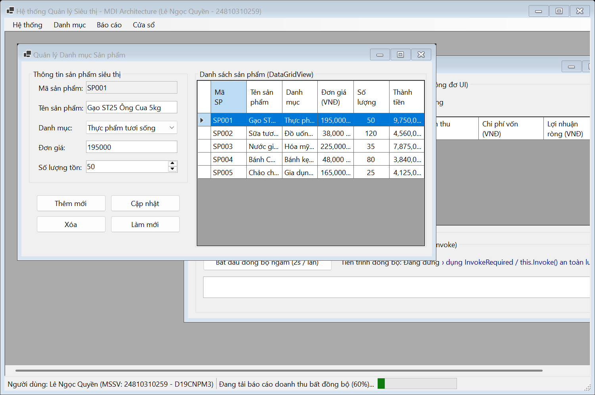
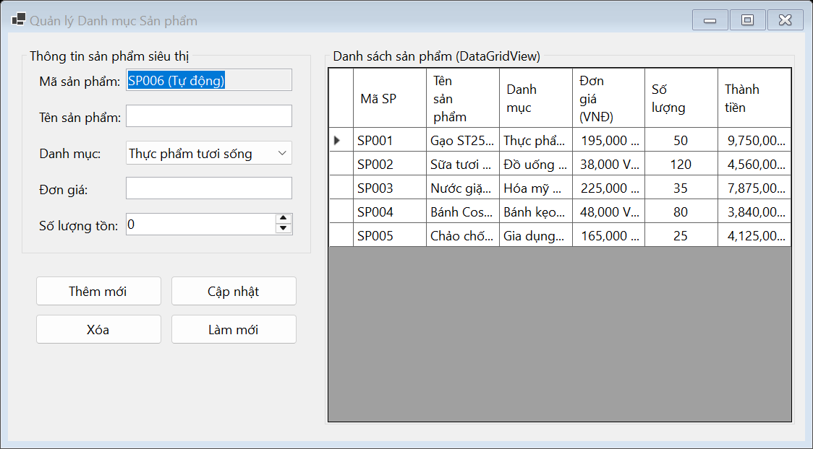
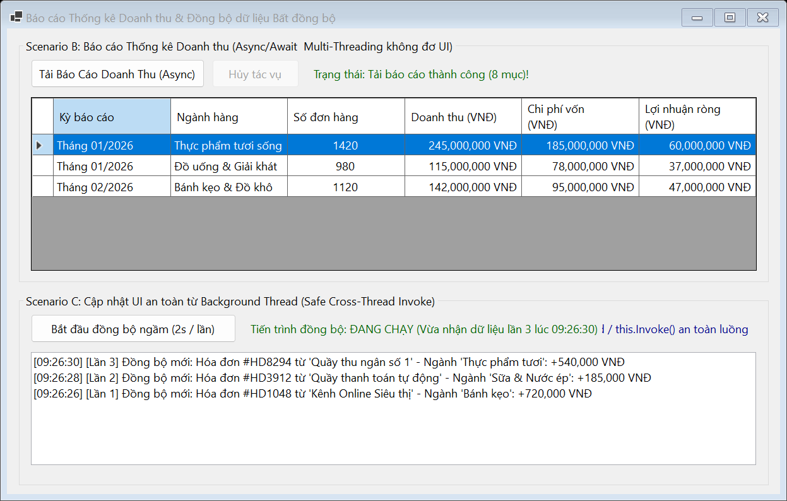

# BÁO CÁO BÀI TẬP / ĐỒ ÁN 
## THÔNG TIN SINH VIÊN 
- **Họ và tên:** Lê Ngọc Quyền 
- **Mã số sinh viên:** 24810310259 
- **Lớp:** D19CNPM3 
- **Tên môn học:** Lập trình C# / Windows Forms 
- **Tên bài tập:** Bài 3: Hệ thống MDI Quản lý siêu thị & Đồng bộ dữ liệu bất đồng bộ (Async/Await & Multi-Threading)
--- 
## KẾT QUẢ THỰC HÀNH 
### 1. Ảnh màn hình Giao diện chính Form MDI 
 
### 2. Ảnh màn hình Form Quản lý Danh mục (frmProductCatalog) 
 
### 3. Ảnh màn hình Form Báo cáo Doanh thu & Đồng bộ đa luồng (frmAsyncReport) 
 
